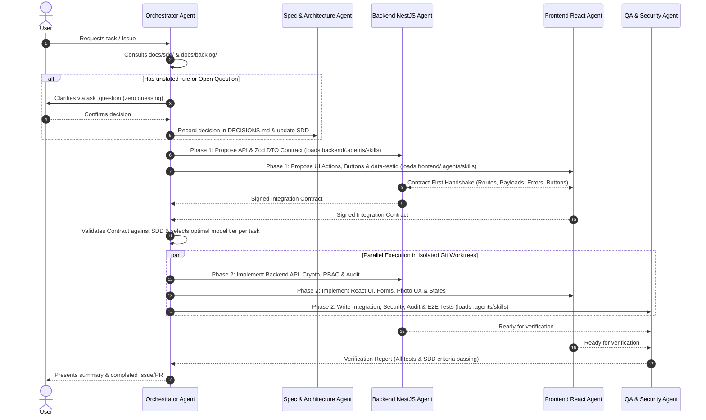

# SIIBS Multi-Agent System Playbooks (`docs/agents/`)

This directory defines the operational architecture, prompts, handoff protocols, skill discovery rules, and token optimization policies for the SIIBS Multi-Agent Engineering Team (`DA-014`).

---

## 1. Agent Roster

| Agent Role | Playbook File | Workspace Scope | Primary Responsibility |
| :--- | :--- | :--- | :--- |
| **1. Orchestrator Agent** | [`orchestrator.md`](./orchestrator.md) | Root (`SIIBS`) | **Sole user contact**, context keeper, model/token router (`flash_lite` / `flash` / `pro`), contract handshake gatekeeper, and escalation resolver. |
| **2. Spec & Architecture Agent** | [`spec-architect.md`](./spec-architect.md) | `docs/sdd/`, `docs/backlog/`, `index.ts` contracts | SDD governance, resolving `OPEN-QUESTIONS.md` into `DECISIONS.md` (after user confirmation via Orchestrator), defining Zod/API contracts. |
| **3. Backend NestJS Agent** | [`backend.md`](./backend.md) | `backend/` (`SIIBS_Back`) | NestJS modules (`iam`, `audit`, `registry`, `assistance`, `education`), PostgreSQL 16 multi-schema, `AES-256-GCM` + `HMAC-SHA256` blind index, RBAC guards, atomic audit transactions, encrypted backup scripts. |
| **4. Frontend React Agent** | [`frontend.md`](./frontend.md) | `frontend/` (`SIIBS_Front`) | React + Vite + TypeScript SPA, Tailwind + shadcn/ui, `pt-BR` operator UX, webcam/upload photo capture, search & record reuse flow, permission-aware UI. |
| **5. QA & Security Agent** | [`qa-security.md`](./qa-security.md) | `backend/`, `frontend/`, `docs/operations/` | Unit, PostgreSQL integration, and Playwright E2E tests, RBAC/privacy isolation tests, encryption-at-rest verification, append-only audit tests, real backup restoration verification. |

---

## 2. End-to-End Multi-Agent Workflow

---

## 3. Distributed Skill Architecture

Skills are loaded progressively from three locations mapped in [`.agents/skills.json`](../../.agents/skills.json):
- **Root General Skills (`.agents/skills/`):** Testing, security auditing, SDD validation, Git worktree helpers, and cross-cutting workflows.
- **Backend Skills (`backend/.agents/skills/`):** NestJS development, PostgreSQL multi-schema, ORM migrations, cryptography (`AES-256-GCM`, `HMAC-SHA256`), and backend patterns.
- **Frontend Skills (`frontend/.agents/skills/`):** UI/UX design system, Tailwind CSS + shadcn/ui, accessible forms, and React patterns.
